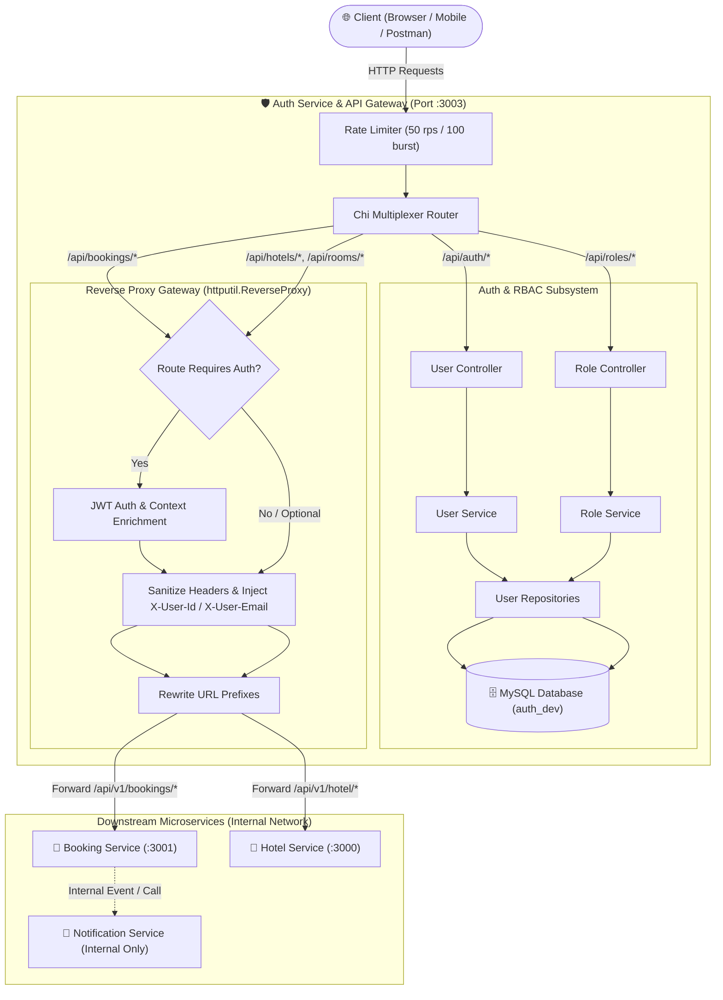
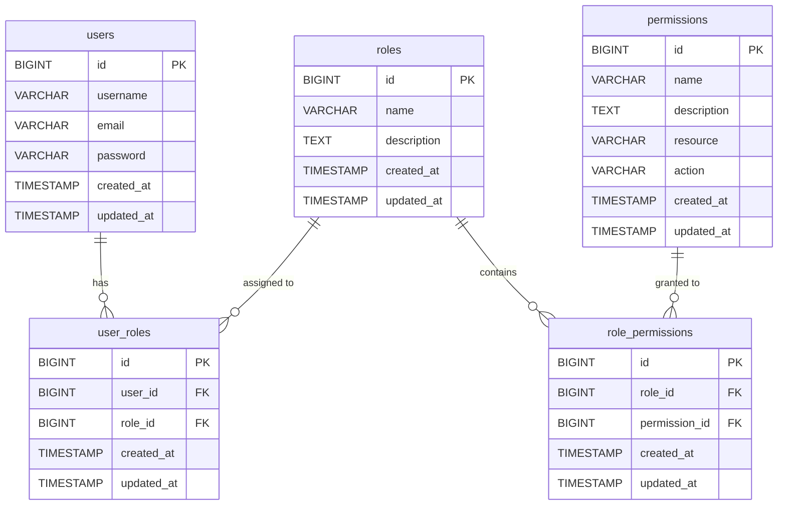

# 🏨 Airbnb Auth Service & API Gateway

A high-performance, secure, and production-grade **Authentication, Authorization (RBAC), and Reverse Proxy API Gateway** service built with **Go (Golang)** for a distributed Airbnb-style microservices ecosystem.

This service serves as the central entry point for client traffic. It manages user accounts, issues and validates JWT credentials, enforces granular role-based access control, defends against abuse via token-bucket rate limiting, and reverse-proxies authenticated requests to downstream services (such as the Booking Service and Hotel Service) with verified identity headers.

---

## 📋 Table of Contents

- [🚀 Quick Start & Installation](#-quick-start--installation)
  - [Prerequisites](#prerequisites)
  - [1. Clone the Repository](#1-clone-the-repository)
  - [2. Environment Configuration](#2-environment-configuration)
  - [3. Install Dependencies & Tools](#3-install-dependencies--tools)
  - [4. Database Setup & Migrations](#4-database-setup--migrations)
  - [5. Run the Application](#5-run-the-application)
- [🏛️ Architecture Overview](#️-architecture-overview)
  - [System Context Diagram](#system-context-diagram)
  - [Clean Layered Architecture](#clean-layered-architecture)
  - [Gateway & Reverse Proxy Pipeline](#gateway--reverse-proxy-pipeline)
  - [Database Schema (RBAC)](#database-schema-rbac)
- [✨ Standout & Impressive Features](#-standout--impressive-features)
  - [1. Dual-Role Architecture: Auth Provider + Reverse Proxy API Gateway](#1-dual-role-architecture-auth-provider--reverse-proxy-api-gateway)
  - [2. Intelligent Reverse Proxy with Hop-by-Hop Header Sanitization](#2-intelligent-reverse-proxy-with-hop-by-hop-header-sanitization)
  - [3. Hybrid JWT Authentication (Secure HttpOnly Cookies & Bearer Headers)](#3-hybrid-jwt-authentication-secure-httponly-cookies--bearer-headers)
  - [4. Granular Dynamic RBAC (Role-Based Access Control)](#4-granular-dynamic-rbac-role-based-access-control)
  - [5. Built-in In-Memory Token-Bucket Rate Limiter](#5-built-in-in-memory-token-bucket-rate-limiter)
  - [6. Zero-Trust Request Validation & Mass-Assignment Protection](#6-zero-trust-request-validation--mass-assignment-protection)
  - [7. Automated Versioned Migrations with Goose](#7-automated-versioned-migrations-with-goose)
  - [8. Standardized JSON Envelope Responses](#8-standardized-json-envelope-responses)
- [📡 API Reference](#-api-reference)
  - [Health Check](#health-check)
  - [Authentication Endpoints (`/api/auth`)](#authentication-endpoints-apiauth)
  - [Role & Permission Management (`/api/roles`)](#role--permission-management-apiroles)
  - [Proxied Downstream Routes](#proxied-downstream-routes)
- [🛠️ Makefile Commands](#️-makefile-commands)
- [📂 Project Directory Structure](#-project-directory-structure)

---

## 🚀 Quick Start & Installation

### Prerequisites

Ensure the following tools are installed on your workstation:
- **[Go](https://go.dev/dl/)**: Version 1.21 or higher (developed on Go 1.27)
- **[MySQL](https://www.mysql.com/)**: Version 8.0 or higher
- **[Goose](https://github.com/pressly/goose)**: Database migration CLI tool
- **[Air](https://github.com/air-verse/air)** *(Optional)*: Live-reloading daemon for local Go development
- **Make** *(Optional)*: For running Makefile shortcuts (or use direct terminal commands)

---

### 1. Clone the Repository

Clone the project repository to your local machine:

```bash
git clone https://github.com/prajjwalmathur90/Auth-Service-AirBnb.git
cd Auth-Service-AirBnb
```

---

### 2. Environment Configuration

Create a `.env` file in the root of the project with your local database and microservice configuration:

```bash
cp .env.example .env   # Or create .env directly
```

#### `.env` Configuration Variables:

```env
# Application Server
PORT=3003

# Database Connection Settings
DB_USER=root
DB_PASSWORD=rootpassword
ADDR=127.0.0.1:3306
DBName=auth_dev
DB_NET=tcp

# Database URL for Goose Migrations
MIGRATION_FOLDER=db/migrations
DB_URL=root:rootpassword@tcp(127.0.0.1:3306)/auth_dev

# Security & JWT Tokens
JWT_SECRET=auth_in_go_secret
JWT_TOKEN=auth_in_go_secret
COOKIE_SECURE=false # Set to true in production with HTTPS

# Downstream Microservices for API Gateway Routing
BOOKING_SERVICE_URL=http://localhost:3001
HOTEL_SERVICE_URL=http://localhost:3000
```

> **Note**: Create the database in MySQL before executing migrations:
> ```sql
> CREATE DATABASE auth_dev CHARACTER SET utf8mb4 COLLATE utf8mb4_unicode_ci;
> ```

---

### 3. Install Dependencies & Tools

Download the Go module dependencies:

```bash
go mod download
go mod tidy
```

Install the Goose database migration tool and Air (if not already installed):

```bash
# Install Goose
go install github.com/pressly/goose/v3/cmd/goose@latest

# Install Air (for live reload)
go install github.com/air-verse/air@latest
```

Ensure your `GOPATH/bin` or `GOBIN` directory is in your system's `PATH`.

---

### 4. Database Setup & Migrations

Execute the versioned database migrations to set up the `users`, `roles`, `permissions`, `user_roles`, and `role_permissions` tables, along with default seed data:

Using **Make**:
```bash
make migrate-up
```

Or using **Goose directly**:
```bash
goose -dir db/migrations mysql "root:rootpassword@tcp(127.0.0.1:3306)/auth_dev" up
```

To inspect migration status:
```bash
make migrate-status
```

---

### 5. Run the Application

You can start the server using any of the following methods:

#### Method A: Live Reloading with Air (Recommended for Development)
```bash
make dev
# or: air
```

#### Method B: Direct Go Run
```bash
make run
# or: go run .
```

#### Method C: Compile and Run Binary
```bash
make build
./bin/app        # On Linux/macOS
.\bin\app.exe    # On Windows
```

Once running, the service will be available at:
```text
http://localhost:3003
```

Verify the service is live:
```bash
curl http://localhost:3003/ping
```

---

## 🏛️ Architecture Overview

### System Context Diagram



---

### Clean Layered Architecture

The codebase strictly adheres to **Clean Architecture / Separation of Concerns**, ensuring modularity, testability, and maintainability:

```text
┌────────────────────────────────────────────────────────┐
│                      HTTP Layer                        │
│   chi Router  ──►  Middlewares (RateLimit, JWT, RBAC,  │
│                    DTO Validation, Context Injection)  │
└───────────────────────────┬────────────────────────────┘
                            │
┌───────────────────────────▼────────────────────────────┐
│                   Controller Layer                     │
│   Parses HTTP requests, extracts DTOs from context,    │
│   invokes Services, sets cookies, formats envelopes    │
└───────────────────────────┬────────────────────────────┘
                            │
┌───────────────────────────▼────────────────────────────┐
│                    Service Layer                       │
│   Business rules, Bcrypt hashing, JWT issuance,        │
│   permission validation, and repository orchestration  │
└───────────────────────────┬────────────────────────────┘
                            │
┌───────────────────────────▼────────────────────────────┐
│               Repository / Data Access                 │
│   Pure database/sql statements, parameterized queries, │
│   scanning into Domain Models, relationship joins      │
└───────────────────────────┬────────────────────────────┘
                            │
┌───────────────────────────▼────────────────────────────┐
│                     MySQL Engine                       │
│    Tables: users, roles, permissions, user_roles, etc. │
└────────────────────────────────────────────────────────┘
```

1. **Entrypoint & Bootstrap (`main.go`, `app/application.go`)**:
   Loads `.env` config, establishes resilient MySQL connection pools, instantiates repositories, services, controllers, and wires up Chi sub-routers.
2. **Router Layer (`router/`)**:
   Defines route groups, mounts middleware, and separates self-handled authentication routes from proxied gateway routes.
3. **Middleware Layer (`middleware/`)**:
   Reusable middleware pipeline for rate limiting, JWT extraction, role/permission enforcement, and payload validation.
4. **Controller Layer (`controllers/`)**:
   Receives HTTP requests, unmarshals validated DTOs, delegates to the service layer, and writes standardized JSON response envelopes.
5. **Service Layer (`services/`)**:
   Contains core domain logic, interfaces (`UserService`, `RoleService`), password hashing, token lifecycle management, and role authorization policies.
6. **Repository Layer (`db/repositories/`)**:
   Pure Go SQL layer with explicit parameterized queries (preventing SQL injection), transactional safety, and relational joins.
7. **Models & DTOs (`models/`, `dto/`)**:
   Strongly typed data transfer objects and database entities with `validator` tags and JSON exclusion tags (e.g., hiding password hashes from JSON serialization).

---

### Gateway & Reverse Proxy Pipeline

The Gateway router intercepts incoming client requests destined for downstream services:

1. **Routing Table**:
   - `/api/bookings` ➔ `http://localhost:3001/api/v1/bookings` *(Mandatory Auth)*
   - `/api/hotels` ➔ `http://localhost:3000/api/v1/hotel` *(Public / Optional Auth)*
   - `/api/rooms` ➔ `http://localhost:3000/api/v1/room` *(Public / Optional Auth)*
   - `/api/room-categories` ➔ `http://localhost:3000/api/v1/room-category` *(Public / Optional Auth)*
   - `/api/room-generation` ➔ `http://localhost:3000/api/v1/room-generation` *(Public / Optional Auth)*
2. **Header Sanitization**: Removes spoofed headers (`X-User-Id`, `X-User-Email`) sent by the client.
3. **Context Enrichment**: Injects verified `X-User-Id` and `X-User-Email` headers from the validated JWT claims.
4. **Credential Translation**: If the client authenticated via an `HttpOnly` cookie, the proxy converts it into an `Authorization: Bearer <token>` header for downstream microservices.
5. **Standard Proxy Headers**: Automatically appends `X-Forwarded-For`, `X-Forwarded-Host`, and `X-Forwarded-Proto`.
6. **Failure Isolation**: Intercepts network drops or unreachable upstream hosts and responds with a standardized `502 Bad Gateway` JSON envelope.

---

### Database Schema (RBAC)



#### Pre-seeded Roles & Permissions:
- **Roles**: `admin`, `user`, `moderator`
- **Permissions**: `user:read`, `user:write`, `user:delete`, `role:read`, `role:write`, `role:delete`, `role:manage`, `permission:read`, `permission:write`, `permission:delete`, `permission:manage`
- **Role Assignments**:
  - `admin`: All system permissions
  - `user`: Standard `user:read` permission

---

## ✨ Standout & Impressive Features

### 1. Dual-Role Architecture: Auth Provider + Reverse Proxy API Gateway
Unlike monolithic auth servers or simple reverse proxies, this project **combines both into a unified gateway**. It satisfies user authentication directly while acting as the single front-facing ingress for downstream Airbnb microservices (Hotels, Bookings, Rooms), protecting internal microservices from being directly exposed to the public internet.

---

### 2. Intelligent Reverse Proxy with Hop-by-Hop Header Sanitization
Built using modern Go's `httputil.ReverseProxy` with the recommended `Rewrite` function:
- **Eliminates Hop-by-Hop Exploits**: `Rewrite` executes *after* standard hop-by-hop headers are removed, preventing attacks where an adversary sends `Connection: X-User-Id` to drop security headers.
- **Header Stripping**: Actively deletes untrusted client-supplied identity headers before attaching verified credentials.
- **Transparent Cookie-to-Header Conversion**: Downstream microservices only need standard `Authorization: Bearer` parsing. The gateway seamlessly converts browser `HttpOnly` cookies to Bearer headers behind the scenes.
- **Fail-Safe Graceful Degradation**: Catches downstream crashes or timeouts with a clean, structured JSON 502 error rather than a raw socket disconnect.

---

### 3. Hybrid JWT Authentication (Secure HttpOnly Cookies & Bearer Headers)
Provides first-class support for both web browser clients and mobile/API clients:
- **XSS-Immune Cookies**: Stores the JWT in a browser `HttpOnly`, `SameSite=Lax` cookie with an expiration TTL of 24 hours. Malicious client scripts cannot access or exfiltrate the token.
- **Bearer Header Fallback**: Automatically checks the `Authorization: Bearer <token>` header if no cookie is present, allowing seamless use with Postman, mobile apps, and service-to-service calls.
- **Cryptographic Integrity**: Validates the signing algorithm (`HMAC-SHA256`) explicitly during parsing to guard against algorithm confusion attacks (e.g., `none` algorithm exploit).

---

### 4. Granular Dynamic RBAC (Role-Based Access Control)
Implements true enterprise-grade authorization middleware:
- **`RequireAllRoles(...roles)`**: Verifies that the authenticated user possesses *all* specified roles using dynamic SQL `COUNT(DISTINCT r.id) = ?`.
- **`RequireAnyRoles(...roles)`**: Verifies that the authenticated user possesses *at least one* of the specified roles using `COUNT(DISTINCT r.id) > 0`.
- **Dynamic Parameter Binding**: Prevents SQL injection by constructing exact placeholder slices `(?, ?, ...)` matching the number of requested roles.
- **Cascade Deletes**: Foreign keys automatically cascade on user or role removal, preserving database integrity.

---

### 5. Built-in In-Memory Token-Bucket Rate Limiter
Guards against brute-force credential stuffing and DDoS attempts:
- Powered by `golang.org/x/time/rate`.
- Configured out of the box with a rate of **50 requests per second** and a burst capacity of **100 requests**.
- Returns a standardized `429 Too Many Requests` JSON response when exceeded.

---

### 6. Zero-Trust Request Validation & Mass-Assignment Protection
- **Strict Decoding**: Configured with `decoder.DisallowUnknownFields()`. Any request payload containing undocumented or rogue fields is rejected immediately with `400 Bad Request`.
- **Declarative Struct Validation**: Powered by `go-playground/validator/v10` using struct tags (`validate:"required,email,min=6,max=12"`).

---

### 7. Automated Versioned Migrations with Goose
All schema changes are tracked as timestamped SQL migrations. The developer workflow is streamlined via Makefile targets:
- `make migrate-up`: Run all pending migrations.
- `make migrate-down`: Rollback the latest migration.
- `make migrate-status`: Inspect applied and pending migrations.
- `make migrate-reset`: Reset the schema from scratch.

---

### 8. Standardized JSON Envelope Responses
Every endpoint (success or error) responds with a uniform JSON envelope:

**Success Response:**
```json
{
  "success": true,
  "message": "User fetched successfully!",
  "data": {
    "Id": 1,
    "Username": "johndoe",
    "Email": "john@example.com",
    "CreatedAt": "2026-10-12 14:00:00",
    "UpdatedAt": "2026-10-12 14:00:00"
  },
  "error": null
}
```

**Error Response:**
```json
{
  "success": false,
  "message": "Insufficient permissions",
  "data": null,
  "error": null
}
```

---

## 📡 API Reference

### Health Check

#### `GET /ping`
Checks if the gateway is running.
- **Auth**: None
- **Response**: `200 OK`
```json
{
  "message": "pong"
}
```

---

### Authentication Endpoints (`/api/auth`)

| Method | Endpoint | Auth Required | Roles Required | Description |
| :--- | :--- | :--- | :--- | :--- |
| `POST` | `/api/auth/signup` | No | None | Registers a new user account & sets JWT cookie |
| `POST` | `/api/auth/login` | No | None | Authenticates user & sets JWT cookie |
| `POST` | `/api/auth/logout` | No | None | Clears the `auth_token` cookie |
| `GET` | `/api/auth/` | Yes | `admin` or `user` | Retrieves all registered users |
| `GET` | `/api/auth/{id}` | Yes | `admin` or `user` | Retrieves user profile by ID |
| `GET` | `/api/auth/{id}/roles` | Yes | `admin` or `user` | Retrieves assigned roles for a user |
| `DELETE` | `/api/auth/{id}` | Yes | `admin` or `user` | Deletes user account (self-deletion only) |

#### 1. Register User (`POST /api/auth/signup`)
**Request Body:**
```json
{
  "username": "johndoe",
  "email": "john@example.com",
  "password": "secretpassword"
}
```
**Validation Rules:**
- `username`: Required, min 3 chars, max 20 chars
- `email`: Required, valid email format
- `password`: Required, min 6 chars, max 12 chars

#### 2. Login User (`POST /api/auth/login`)
**Request Body:**
```json
{
  "email": "john@example.com",
  "password": "secretpassword"
}
```
**Response Header:**
```http
Set-Cookie: auth_token=<jwt_token>; Path=/; Max-Age=86400; HttpOnly; SameSite=Lax
```

---

### Role & Permission Management (`/api/roles`)

> **Note**: All routes under `/api/roles` require valid JWT authentication **AND** the `admin` role.

| Method | Endpoint | Description |
| :--- | :--- | :--- |
| `GET` | `/api/roles` | List all available roles |
| `POST` | `/api/roles` | Create a new role |
| `GET` | `/api/roles/{id}` | Get role details by ID |
| `PUT` | `/api/roles/{id}` | Update role name / description |
| `DELETE` | `/api/roles/{id}` | Delete a role |
| `GET` | `/api/roles/{id}/permissions` | List permissions mapped to a role |
| `POST` | `/api/roles/{id}/permissions` | Attach a permission to a role |
| `DELETE` | `/api/roles/{id}/permissions/{permissionId}` | Detach a permission from a role |
| `POST` | `/api/roles/users/{userId}` | Assign a role to a specific user |

#### Example: Assign Role to User (`POST /api/roles/users/{userId}`)
**Request Body:**
```json
{
  "role_id": 1
}
```

---

### Proxied Downstream Routes

| Public Gateway Route | Upstream Service Target | Rewritten Target Path | Authentication |
| :--- | :--- | :--- | :--- |
| `/api/bookings/*` | Booking Service (`:3001`) | `/api/v1/bookings/*` | **Mandatory JWT** |
| `/api/hotels/*` | Hotel Service (`:3000`) | `/api/v1/hotel/*` | Optional / Public |
| `/api/rooms/*` | Hotel Service (`:3000`) | `/api/v1/room/*` | Optional / Public |
| `/api/room-categories/*` | Hotel Service (`:3000`) | `/api/v1/room-category/*` | Optional / Public |
| `/api/room-generation/*` | Hotel Service (`:3000`) | `/api/v1/room-generation/*` | Optional / Public |

> Downstream microservices receive proxied requests enriched with:
> - `X-User-Id: <id>` (when authenticated)
> - `X-User-Email: <email>` (when authenticated)
> - `Authorization: Bearer <token>`
> - `X-Forwarded-For`, `X-Forwarded-Host`, `X-Forwarded-Proto`

---

## 🛠️ Makefile Commands

The included `Makefile` provides convenient shortcuts for common developer tasks:

```bash
# Application Execution
make run              # Run using 'go run .'
make dev              # Run with live-reloading via 'air'
make build            # Compile binary to bin/app

# Database Migrations (Goose)
make migrate-up       # Apply all pending migrations
make migrate-down     # Rollback the last migration
make migrate-status   # Show migration status
make migrate-redo     # Rollback and re-apply the last migration
make migrate-reset    # Rollback all migrations
make migrate-create name="add_indexes" # Create a new timestamped migration file
make migrate-to version=20261002080744 # Migrate up to a specific version
make migrate-down-to version=20261002080744 # Migrate down to a specific version
```

---

## 📂 Project Directory Structure

```text
Auth-Service/
├── app/
│   └── application.go         # Application bootstrap & dependency wiring
├── config/
│   ├── db/
│   │   └── db.go              # MySQL connection pool initialization
│   └── env/
│       └── env.go             # Type-safe environment variable helpers
├── controllers/
│   ├── ping.go                # Healthcheck handler
│   ├── role_controller.go     # RBAC HTTP controller
│   └── user_controller.go     # User & Auth HTTP controller
├── db/
│   ├── migrations/            # Versioned Goose SQL migration files
│   │   ├── 20261002080744_create_user_table.sql
│   │   ├── 20261007054742_create_role_table.sql
│   │   ├── 20261007054757_create_permissions_table.sql
│   │   ├── 20261007054844_create_user_roles_table.sql
│   │   └── 20261007060340_create_role_permissions_table.sql
│   └── repositories/          # Data Access Layer (SQL queries & interfaces)
│       ├── permissions.go
│       ├── role_permissions.go
│       ├── roles.go
│       ├── storage.go
│       ├── user_repository.go
│       └── user_roles.go
├── dto/
│   ├── auth.go                # Signup and Login DTOs with validation rules
│   └── role.go                # Role and Permission management DTOs
├── middleware/
│   ├── auth.go                # JWT authentication & RequireRoles middlewares
│   ├── rate_limiter.go        # Token-bucket rate limiter middleware
│   ├── role_validator.go      # RBAC request body validation middleware
│   └── validator.go           # Auth request body validation middleware
├── models/
│   ├── rbac_models.go         # Role, Permission, RolePermission structs
│   └── user_models.go         # User model struct
├── router/
│   ├── gateway_router.go      # Reverse proxy route registration & targets
│   ├── role_router.go         # Role & permission route definitions
│   ├── router.go              # Root Chi router configuration & middlewares
│   └── user_router.go         # User & auth route definitions
├── services/
│   ├── role_services.go       # RBAC business logic implementation
│   └── user_service.go        # User authentication & token business logic
├── utils/
│   ├── auth.go                # Bcrypt password hashing & comparison
│   ├── cookie.go              # Secure HttpOnly cookie helpers
│   ├── json.go                # JSON request/response envelope helpers
│   └── proxy.go               # httputil ReverseProxy with header rewriting
├── .env                       # Local environment variables
├── .gitignore                 # Git ignore rules
├── go.mod                     # Go module definitions
├── go.sum                     # Go module checksums
├── main.go                    # Application entrypoint
├── Makefile                   # Build, dev, and migration automation commands
└── README.md                  # Project documentation
```

---

## 🔒 Security Best Practices Implemented

- **Password Hashing**: Utilizes **Bcrypt** with default salt cost for all stored credentials.
- **XSS Mitigation**: Authentication tokens are kept inside **`HttpOnly` cookies**, unreachable by rogue frontend JavaScript.
- **CSRF Defense**: Cookies are restricted with **`SameSite=Lax`**.
- **Header Injection Prevention**: Upstream identity headers (`X-User-Id`, `X-User-Email`) are wiped before request forwarding, preventing client-side identity spoofing.
- **SQL Injection Prevention**: 100% of SQL queries use parameterized arguments (`?`).
- **Mass Assignment Defense**: `DisallowUnknownFields()` guarantees unmapped JSON keys are blocked before hitting controllers.
- **DoS / Brute Force Mitigation**: Rate limiting throttles excessive requests across all gateway routes.

---

## 📄 License

This project is licensed under the [MIT License](LICENSE).
